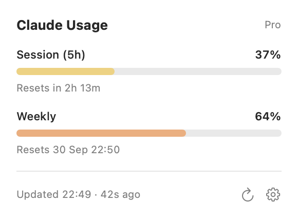

<div align="center">

# Claude Usage

**Your Claude plan usage, always one glance away in the macOS menu bar.**

[](https://github.com/timofeykhodykin/mac-claude-usage/releases/latest)


[](LICENSE.md)

<picture>
  <source media="(prefers-color-scheme: dark)" srcset="docs/dropdown-dark.png">
  
</picture>

<picture>
  <source media="(prefers-color-scheme: dark)" srcset="docs/menubar-dark.png">
  
</picture>

[**Download**](https://github.com/timofeykhodykin/mac-claude-usage/releases/latest) ·
[How it works](#how-it-works) ·
[Changelog](CHANGELOG.md)

</div>

## Features

- **Session usage in the menu bar**, like `37%`, or session and weekly together: `37% / 64%`.
- **Both limits one click away**, with progress bars and reset times.
- **Never goes stale.** It renews Claude Code's sign-in in step with Claude Code, so it
  keeps working even if you haven't opened Claude Code for days.
- **Gentle on rate limits.** It reuses the numbers Claude Code already gets, and calls the
  usage API only when it has to.
- **Honest when offline.** If usage can't be fetched, the menu bar shows `?` and the
  dropdown keeps the last known numbers.
- **Native and tiny.** Swift and SwiftUI, no dependencies, no telemetry.

## Install

You need macOS 15 or later and [Claude Code](https://claude.com/claude-code) signed in
with a Claude Pro or Max plan.

1. Download `Claude-Usage-X.Y.Z.zip` from the
   [latest release](https://github.com/timofeykhodykin/mac-claude-usage/releases/latest),
   unzip it, and move **Claude Usage** to Applications.
2. Open it. The app isn't notarized, so macOS blocks the first launch: go to
   **System Settings → Privacy & Security** and click **Open Anyway**.
3. Optional: in Settings (the gear in the dropdown), turn on **Launch at login**.

<details>
<summary><b>Build from source</b></summary>

<br>

Requires Xcode or the Command Line Tools (`xcode-select --install`).

```bash
git clone https://github.com/timofeykhodykin/mac-claude-usage.git
cd mac-claude-usage
./scripts/build-app.sh --install
```

This builds the app, copies it to `~/Applications`, and launches it. A build made on your
own Mac opens without the Gatekeeper prompt.

</details>

<details>
<summary><b>Uninstall</b></summary>

<br>

In Settings, turn off **Live updates from Claude Code** to restore your old status line,
then quit the app and delete it. Your original `~/.claude/settings.json` is also kept as
`settings.json.before-mac-claude-usage`.

</details>

## How it works

<details>
<summary><b>Sharing Claude Code's sign-in without logging it out</b></summary>

<br>

Claude Code keeps its login in the Keychain item `Claude Code-credentials`. Its refresh
token is **single-use**, which is why other usage monitors either go stale (they only read
the token) or log Claude Code out (they refresh it into their own storage).

This app refreshes the token **exactly like another Claude Code process would**:

1. Only when less than 5 minutes are left, the same threshold Claude Code uses.
2. Under Claude Code's own cross-process locks (`~/.claude/.oauth_refresh.lock`,
   `~/.claude.lock`), re-reading the Keychain first in case Claude Code already did it.
3. Writing the result back into the **same** Keychain item as a compare-and-swap, keeping
   every other field.

Running Claude Code sessions pick up the new token without noticing. Keychain access goes
through Apple's `/usr/bin/security`, so there are no password prompts.

</details>

<details>
<summary><b>Where the numbers come from</b></summary>

<br>

The usage API is rate-limited hard, so the app takes the cheapest source available:

| Source | When | Cost |
|---|---|---|
| Claude Code's **status line**, which the app registers itself as | after every Claude Code reply | free |
| Claude Code's cached **`/usage`** in `~/.claude.json` | if under an hour old | free |
| The **usage API** | only when the data above is older than the refresh interval | rate-limited |

As a status line it prints the usual `Opus 5.5 · 11% · 113K/1M` context readout. It only
takes the status line if it's free, and never overwrites another tool's. On `HTTP 429` it
backs off exponentially, up to 30 minutes.

</details>

## Privacy

- Talks only to `api.anthropic.com` and `platform.claude.com`, the same hosts Claude Code uses.
- Tokens stay in Claude Code's Keychain item: never logged, cached, or sent anywhere else.
- Writes only its preferences, one usage snapshot in `~/Library/Application Support/MacClaudeUsage/`,
  and the `statusLine` entry in `~/.claude/settings.json` (backed up first).

<details>
<summary><b>Troubleshooting</b></summary>

<br>

```bash
/usr/bin/log stream --predicate 'subsystem == "dev.mac-claude-usage"' --info
```

Shows every fetch, token refresh, and status-line update. Never shows tokens.

| Message | Meaning |
|---|---|
| `Rate limited …; pausing …` | The usage API returned 429. It clears on its own. |
| `Refresh token rejected (invalid_grant)` | The login was revoked. Run `claude` and `/login` once. |
| `Status line: no rate_limits in payload` | Normal until the first reply in a Claude Code session. |

</details>

<details>
<summary><b>Development</b></summary>

<br>

```bash
swift build                    # debug build
./scripts/test.sh              # unit tests (works with the Command Line Tools only)
./scripts/build-app.sh         # universal release app in dist/
./scripts/screenshots.sh       # regenerate docs/*.png from the real views
./scripts/release.sh X.Y.Z     # release a new version
```

Versions follow [Semantic Versioning](https://semver.org). Note each change under
**Unreleased** in [CHANGELOG.md](CHANGELOG.md). `release.sh` turns those notes into the
new version, tags it, and pushes; the tag makes GitHub Actions build the app and publish
the release.

</details>

## License

[PolyForm Noncommercial 1.0.0](LICENSE.md): free for personal and other noncommercial use.
For commercial use, [get in touch](https://github.com/timofeykhodykin).

Unofficial and not affiliated with Anthropic. Claude is a trademark of Anthropic, PBC.
